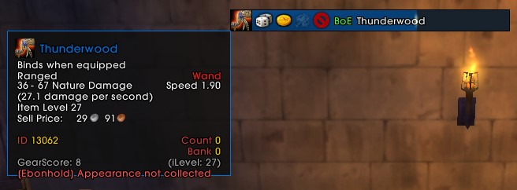
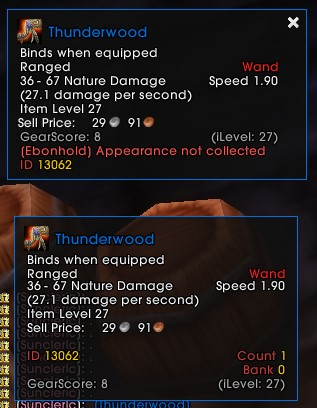
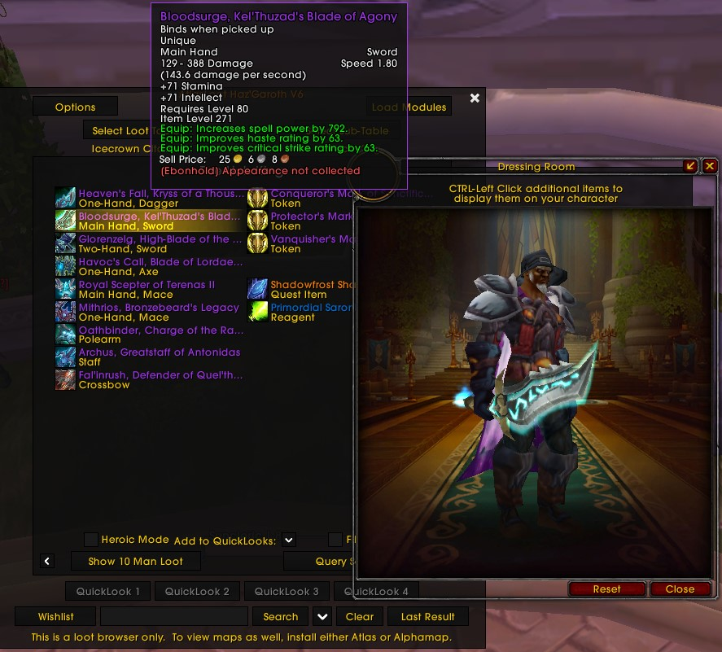
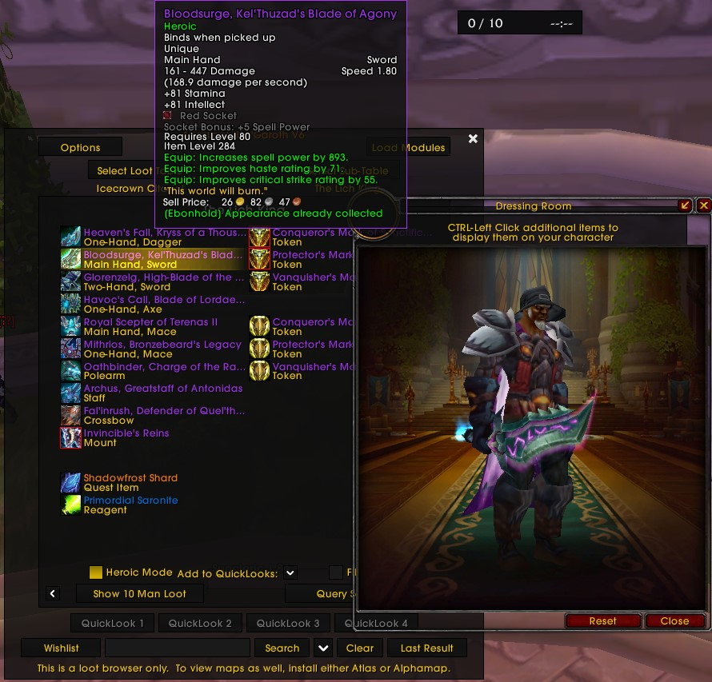

# EbonTransmogCheck

A World of Warcraft 3.3.5a addon for Ebonhold. It checks whether the appearance of an item in a Need/Greed loot roll is already in the player's collection.

## Features

- Shows an ownership marker on loot-roll item icons and adds collection status to the loot tooltip.
- Hold Ctrl while hovering over a loot-roll item to preview it in the dressing room.
- Select English, French, German, Russian, or Spanish under **Interface > AddOns > EbonTransmogCheck**.
- Change language with `/etmc lang en`, `/etmc lang fr`, `/etmc lang de`, `/etmc lang ru`, or `/etmc lang es`.

## Screenshots

## Requirement

The Ebonhold `ProjectEbonhold` addon must be installed and enabled. EbonTransmogCheck reads the synchronized appearance collection from its `ezCollections` API; it cannot query the collection without that addon.

## Installation

1. Download [EbonTransmogCheck.zip](https://github.com/MarkusLastu/EbonTransmogCheck/releases/latest/download/EbonTransmogCheck.zip).
2. Extract the `EbonTransmogCheck` folder into `Interface/AddOns`.
3. Enable both `ProjectEbonhold` and `EbonTransmogCheck` on the character selection screen.

The status describes whether the appearance is collected. The server may still add a particular item source even when another item with the same appearance is already collected.

## Acknowledgements

Thanks to Yosheema, who came up with the original idea for this addon.
